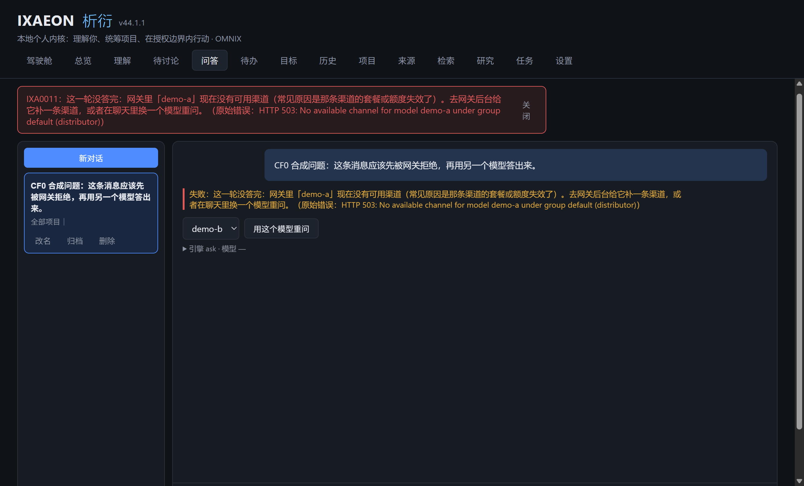
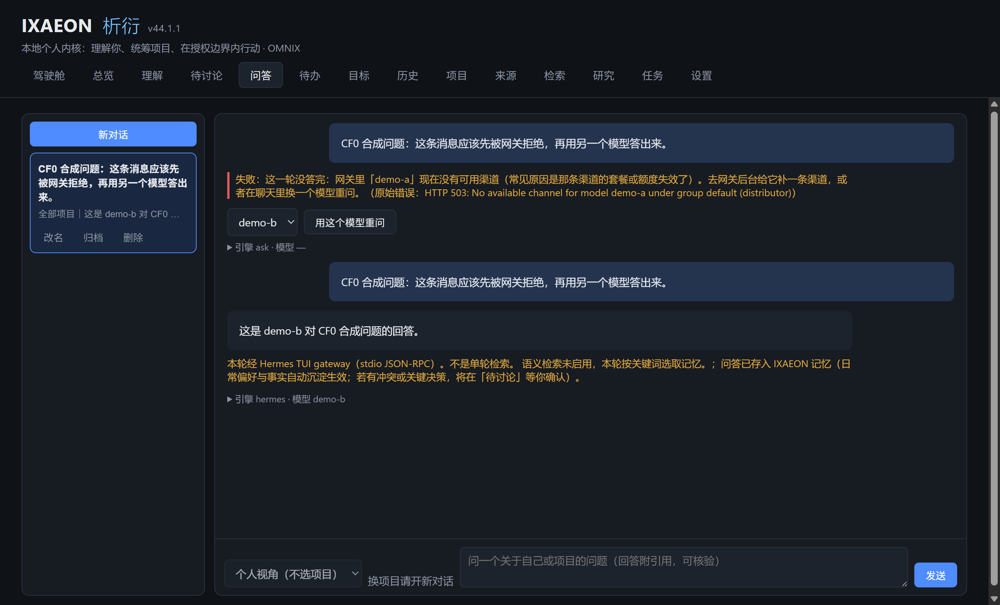

# CF0 聊天先能用：模型没渠道时说清是哪个模型、能在聊天里换个已保存的模型重问 交付

- 分支：`dev/CF0`，基于 main `e73ef2d`；档位 A
- 执行方：dev

## 已实现

- `packages/contracts/src/modelErrors.ts`（新）：`isModelUnavailable(detail)` 认规格列的四种说法
  （`No available channel for model <名字>`、`The model \`<名字>\` does not exist`、
`model <名字> not found`、`model_not_found`，不分大小写），尽量取模型名，取不到回
`{ model: null }`。三条带名字的规则先跑，最后才认 `model_not_found`——网关常见的
`{"message":"The model \`x\` does not exist","code":"model_not_found"}` 两种说法同时出现时，
名字照样取得到；取到的是 was / is 这类虚词时当没取到。另外也认本任务自己的说明句
  （`网关里「…」现在没有可用渠道`）：失败说明的「原始错误」被截短时，界面仍认得出是哪个模型。
- `packages/core/src/runtime/modelErrors.ts`：`explainModelFailure` 在这类失败时改说
  「网关里「<模型名>」现在没有可用渠道（常见原因是那条渠道的套餐或额度失效了）。去网关后台给它
  补一条渠道，或者在聊天里换一个模型重问。」，后面照旧接 `（原始错误：…）`；不再出现
  「稍后再试」。别的 5xx、429、超时、401/403 的说法一个字没动。`isModelUnavailable` 从
  `packages/core/src/index.ts` 一起导出。
- 聊天页（`Ask.tsx` / `AskMessage.tsx`）：失败消息的 `errorMessage` 认出是这类原因时，在失败
  那条下面出「换个模型重问」控件：下拉框只列设置里已检测并保存的 `savedModels`、去掉刚失败的
  那个，按钮「用这个模型重问」。没有别的已保存模型时不出下拉框，改出「设置里还没有别的可用模型」
  和跳到设置页「模型接入」的按钮（`App.tsx` 把设置页滚到那张卡片）。超时、429、别的 5xx 不出
  这个控件。
- 换模型走**现有保存设置的通道** `saveModelSettings({ modelName, chatModelName })`，没有新加
  写配置的 IPC：`modelName` 是现有通道必填的分析模型，聊天页从 `getSettings()` 原样带回去，
  只改 `chatModelName`（下一问生效，旧引擎会话会被丢掉）。重问走和输入框发送同一条
  `askQuestion` 路径，在同一个对话里重发失败回答前面那条用户消息的原话；失败消息不删、不改写。
  正在答另一轮时 `busy` 挡住重问（按钮同时禁用）；保存设置还没返回时也有本地的进行中标记，
  连续点击不会把同一句发两遍。
- 设置页的「滚到模型接入」按 `focus.at` 只做一次，之后保存别的设置重读 `view` 不会再拽回顶部。

改动文件与行数（提交后 `git diff --stat origin/main...HEAD` 原样贴）：

```
 apps/desktop/src/renderer/src/App.tsx              |  13 +-
 apps/desktop/src/renderer/src/pages/Ask.tsx        |  72 +++-
 apps/desktop/src/renderer/src/pages/AskMessage.tsx |  96 ++++++
 apps/desktop/src/renderer/src/pages/Settings.tsx   |  18 +-
 apps/desktop/src/renderer/src/styles.css           |  17 +
 .../desktop/test/acceptance/cf0-chat-retry.test.ts | 316 ++++++++++++++++++
 .../交付/CF0-Codex审查.md                          |  18 +
 .../交付/CF0.md                                    | 161 ++++++++
 .../交付/cf0-1-model-unavailable.png               | Bin 0 -> 236556 bytes
 .../交付/cf0-2-retry-answered.png                  | Bin 0 -> 298119 bytes
 docs/委派/锁定验收.json                            |   9 +
 packages/contracts/src/index.ts                    |   1 +
 packages/contracts/src/modelErrors.ts              |  47 +++
 packages/core/src/index.ts                         |   2 +-
 packages/core/src/runtime/modelErrors.ts           |  17 +
 .../core/test/acceptance/cf0-model-errors.test.ts  | 107 ++++++
 scripts/real/cf0-chat-retry.mjs                    | 364 +++++++++++++++++++++
 17 files changed, 1251 insertions(+), 7 deletions(-)
```

（上面这份 stat 取自本轮整改提交；交付说明里这段统计文字是在它之后补的，只让 `CF0.md` 自己
再多几行，不进源码行数。）

源码改动 283 行（`apps/*/src` + `packages/*/src`：`AskMessage.tsx` +96、`Ask.tsx` +72、
`Settings.tsx` +18、`styles.css` +17、`App.tsx` +13/−1、`contracts/modelErrors.ts` +47、
`contracts/index.ts` +1、`core/runtime/modelErrors.ts` +17、`core/index.ts` +1/−1），在 300 行以内；
验收测试、真机脚本、交付说明、锁定清单不计入。

和规格不一样的一处：`isModelUnavailable` 的实现放在 `packages/contracts`（core 里再导出）。
原因是聊天页（渲染进程）不能引 `@ixaeon/core`：那会把 better-sqlite3 等主进程依赖打进渲染包。
规格要求的「`packages/core/src/index.ts` 一起导出」照样成立，主进程和界面共用同一份判定。

规格条件 8 是「`setChatModel`（**如果加了**）」。现有保存设置的通道可以只带 `modelName` 和
`chatModelName`，不必带 Key、地址，所以本棒没有新开 IPC，条件 8 不适用；换模型的正路由界面
测试条件 5 覆盖（`saveModelSettings` 收到 `{ modelName: 分析模型, chatModelName: demo-b }`，
聊天模型变成 demo-b、分析模型不动）。

## 验收测试（v2 规格任务）

- `packages/core/test/acceptance/cf0-model-errors.test.ts`（11 条）——条件 1、2、3：
  条件 1 逐字断言 demo-a / 没有可用渠道 / 换一个模型 / 不含稍后再试，`isModelUnavailable` 回
  `{ model: 'demo-a' }`；条件 2 的 `model_not_found`（取不到名字写「这个模型」）与
  `The model \`demo-b\` does not exist`，另加规格要求 1 里列的 `model demo-c not found`、
  两种说法同时出现（取到 demo-d）、说明被截短仍从说明句取到 demo-e、
  `The requested model was not found` 不把虚词 was 当名字（写「这个模型」）；条件 3 对
  502 / 429 / 超时 / 401 逐字比对改前的说明，并断言 `isModelUnavailable` 回 null。
- `apps/desktop/test/acceptance/cf0-chat-retry.test.ts`（5 条）——条件 4、5、6、7：
  失败消息下面出现下拉框且选项正好 demo-b、demo-c；选 demo-b 重问后设置改成 demo-b（分析模型
  仍是 demo-a，且 `saveModelSettings` 的调用顺序在 `askQuestion` 之前）、同一个对话多出一问一答、
  问的是原话、失败消息还是 failed；只有失败的那个模型时不出下拉框、出提示和去设置的按钮；
  超时和 429 两类失败都不出控件。
- `apps/desktop/test/acceptance/cf0-chat-model-switch.test.ts`（1 条）——换模型走的现有保存
  通道只改 `chatModelName`：分析模型、API 地址、Key、`savedModels` 都不动，`keyCleared: false`，
  配置落盘；全程一次 `fetch` 都没有。

已用 `node scripts/acceptance.mjs lock CF0 "CF0 聊天先能用：模型没渠道时说清是哪个模型、能在聊天里换个已保存的模型重问" packages/core/test/acceptance/cf0-model-errors.test.ts apps/desktop/test/acceptance/cf0-chat-retry.test.ts apps/desktop/test/acceptance/cf0-chat-model-switch.test.ts` 登记指纹。

## 自动化通过

- `node scripts/acceptance.mjs run CF0`：`Test Files 3 passed (3)`、`Tests 17 passed (17)`。
- `node scripts/verify.mjs`：**全部通过，退出码 0**（本机，任务分支 `dev/CF0`，日志
  `.logs/verify-cf0-2.log`；第一次也是全过，只是 PowerShell 把子进程 stderr 记成包装器退出码 1，
  第二次重定向后 `VERIFY_EXIT=0`）。各步：lint、format:check、local-user（1058 个跟踪文件里没有
  本机账户名）、typecheck、typecheck-acceptance、build 都 ✓；unit 13 个文件 69 条 ✓；
  integration 83 个文件 483 条通过、9 个文件 17 条跳过（原有跳过）；acceptance-lock：90 个任务的
  177 个锁定验收测试都没被改 ✓；acceptance：163 个文件 1271 条 ✓；review 各套件与 4 组真 Electron
  界面都 ✓。
- GitHub 上的 verify：**本棒看不到**。接力指令写明「这一棒的推送由调度器替你做：你只提交，不要
  git push」，分支要等本棒结束后才由调度器推上去；本棒按 L15 的做法先在本机跑同一条 `verify.mjs`。

## 真机通过

规格「真机检查 甲」照做：本机起一个合成的 OpenAI 兼容假网关（`demo-a` 回
`HTTP 503: No available channel for model demo-a under group default (distributor)`，`demo-b`
正常回答），设 `IXAEON_DATA_DIR=<临时目录>` 启动构建好的应用。Hermes 用**临时的
`IXAEON_HERMES_HOME`**（里面只有一份合成的 config.yaml，provider 指向假网关），不读也不改用户
Hermes 的 config.yaml / 会话 / 凭据。首次向导和设置页都填假网关地址与合成 Key，检测并保存
demo-a / demo-b / demo-c，聊天模型选 demo-a，问一句；再选 demo-b 点「用这个模型重问」。

脚本：`scripts/real/cf0-chat-retry.mjs`（本机跑，输出原样贴在下面，临时目录/账户名已遮）：

```
FAKE_GATEWAY http://127.0.0.1:63046/v1
SETTINGS_CHAT_MODEL demo-a
截图： D:\Agent\Worktrees\IXAEON\dsh\CF0\.logs\cf0-real\cf0-1-model-unavailable.png
FAILURE_TEXT 失败：这一轮没答完：网关里「demo-a」现在没有可用渠道（常见原因是那条渠道的套餐或额度失效了）。去网关后台给它补一条渠道，或者在聊天里换一个模型重问。（原始错误：HTTP 503: No available channel for model demo-a under group default (distributor)） demo-b demo-c 用这个模型重问 引擎 ask · 模型 —
RETRY_OPTIONS ["demo-b","demo-c"]
截图： D:\Agent\Worktrees\IXAEON\dsh\CF0\.logs\cf0-real\cf0-2-retry-answered.png
FAILED_MESSAGE_STILL_THERE 1
SAME_QUESTION_TIMES 2
GATEWAY_REQUESTS [{"model":"demo-a","stream":false},{"model":"demo-a","stream":true},{"model":"demo-a","stream":false},{"model":"demo-a","stream":true},{"model":"demo-a","stream":false},{"model":"demo-a","stream":true},{"model":"demo-b","stream":false},{"model":"demo-b","stream":true},{"model":"demo-a","stream":true},{"model":"demo-a","stream":true}]
RESULT 通过：没渠道说清了 demo-a、失败下面能换 demo-b 在同一个对话里重问出答案，失败消息仍留着
```

截图（合成数据，已遮掉临时目录）：

1. 失败说明和换模型控件：`docs/委派/交付/cf0-1-model-unavailable.png`
2. 换 demo-b 重问后答出来、失败消息还在：`docs/委派/交付/cf0-2-retry-answered.png`





**乙（用户做）：待用户实测。** 用户在自己的网关里补好渠道或换好模型后，在 IXAEON 里问通一句，
才算这一条的乙通过；本棒没碰用户的真实网关和 Hermes 配置，不能写成已通过。

## Codex 审查（A 档）

Codex 额度用完，`codex-review.mjs` 改用 Claude 代审（L17）。第 1 轮结论：**需要修改**。

必须改的四条与处理：

1. `model_not_found` 判定排在取名字的规则之前，两种说法同时出现时会丢掉名字。已改：三条带名字的
   规则先跑，最后才认 `model_not_found`；补了「两种说法同时出现」和「说明被截短」两条测试，重新
   `lock`。
2. 新开的 `setChatModel` IPC 不满足规格「只有现有通道必须连同 Key、地址一起传时才新加」的前提。
   已改：删掉 `setChatModel`（`AppRuntime` / ipc.ts / preload / `IxaIpcApi` 全部去掉），聊天页
   改回现有通道 `saveModelSettings({ modelName, chatModelName })`；条件 8 因此不适用（规格写的是
   「如果加了」）。
3. 另一轮正在回答时点重问，会先改模型再被 `ask()` 的 busy 挡住，模型被悄悄换掉、却没重问。已改：
   `retryWithModel` 开头判 `busy`，按钮同时用 `retryDisabled={busy}` 禁用。
4. 交付说明的改动统计只有「（见下）」占位。已补上。

建议的几条：

- contracts 行数 44 vs 39 对不上、源码合计数字——按最终 `git diff --stat` 改正。
- 失败模型的回退顺序改为 `m.modelName` 优先于当前 `chatModelName`：已改。
- 说明被截短时可能认不出：已在 `isModelUnavailable` 里加认本任务说明句的规则，并补测试。
- 设置页 `focus` 每次 `reload()` 都重滚：已按 `focus.at` 只滚一次。
- Core 兜底仍用 `modelName`（已知缺口 3）：保留给整合方确认，本棒不扩大规格。

第 2 轮（`42537a5` + 本轮整改）：结论 **可以合并**，没有「必须改」；建议照做了：

- 界面测试开头注释还写着 `api.setChatModel`：已改成 `saveModelSettings({ modelName, chatModelName })`。
- 条件 5 没钉住「先改模型、再重问」：已用 `invocationCallOrder` 断言 `saveModelSettings` 在
  `askQuestion` 之前。
- 保存设置还没返回时连点两下会发两遍原话：已加 `retrying` 引用，保存前就挡住第二次。
- `model <名字> not found` 会把 `The requested model was not found` 里的 was 当模型名：已加虚词
  排除，这种情况写「这个模型」，并补测试。
- 交付统计与分支对不上 / 第 1 轮审查文件没进分支：本轮把 `<任务号>-Codex审查.md` 和最终统计一起
  提交（统计见上，取自本轮整改提交；这段文字补进来后只让 `CF0.md` 自己的行数再变）。
- 人工确认「只传 modelName + chatModelName 会不会清 Key / 地址 / 已保存清单 / 发网络请求」：
  已加后端测试 `cf0-chat-model-switch.test.ts`，用真的 `AppRuntime.saveModelSettings` 钉住
  Key、地址、分析模型、`savedModels` 都不变、`keyCleared: false`、一次 `fetch` 都没有。
- 人工确认「两张公开仓库截图里有没有本机账户名 / 临时目录 / 真实数据」：截图是假网关上合成的
  demo-a/demo-b 对话，画面里只有应用界面与合成问题；没有路径、账户名、Key、真实网关。已人工
  看过两张图（2614×1582）。

## 已知缺口

1. 分支的 GitHub verify 在本棒看不到（调度器棒末才推）；本机 `verify.mjs` 与 CI 是同一条命令。
2. 真机甲的聊天是**真 Hermes + 合成 config.yaml + 假网关**，不是用户自己的网关；乙仍待用户。
3. 聊天模型切换只影响 Hermes 那条路（`chatModelName` 传给 Hermes）。没装 Hermes 时走
   Core 有界兜底，兜底用的 provider 仍是分析模型 `modelName`（`getProvider()`），所以在那种
   情况下「换个模型重问」换的是 Hermes 用的模型，下一问的 Core 兜底仍会用分析模型。规格契约
   写的是「现有改聊天模型的路径怎么让 Hermes 换模型，照它来」，本棒按这条做，没有扩大改动。
   **这一条请整合方定**：要不要让 Core 兜底也按 `chatModelName` 选模型（那是另一条行为改动，
   不在 CF0 的验收条件里）。
4. 真机日志里 `demo-b` 答完后还有几次 `demo-a` 请求（Hermes 的辅助任务，例如生成标题，仍用
   config.yaml 的默认模型）；主对话不受影响，但辅助任务在 demo-a 没渠道时也会失败，属于 Hermes
   自己的辅助模型选择，不在 CF0 范围。
5. 条件 6 的去设置按钮只在界面测试里验了「按钮在、点了回调」：`App.tsx` 切到设置页并把设置页
   滚到「模型接入」是这次一起加的，严格意义上的滚动位置没有断言（jsdom 没有布局）；
   真机甲没有走这条路径（假网关里还有别的模型）。
6. 换模型走的是现有 `saveModelSettings` 通道，它不校验 `chatModelName` 是否在 `savedModels` 里；
   界面只从已保存清单里出选项，主进程这层没有新增拒绝逻辑（规格只在「如果加了新 IPC」时要求
   拒绝，本棒没加）。

## 用户接受

未发生（用户用过并认可之后才写）。
