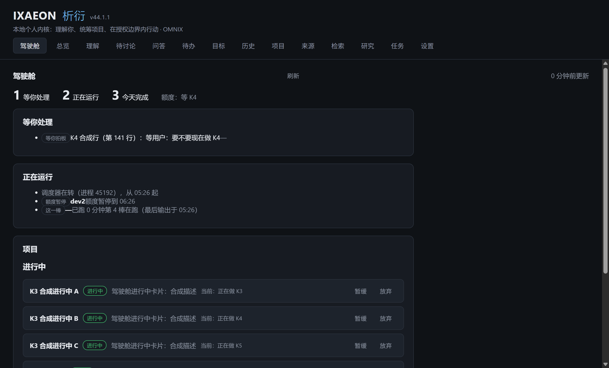
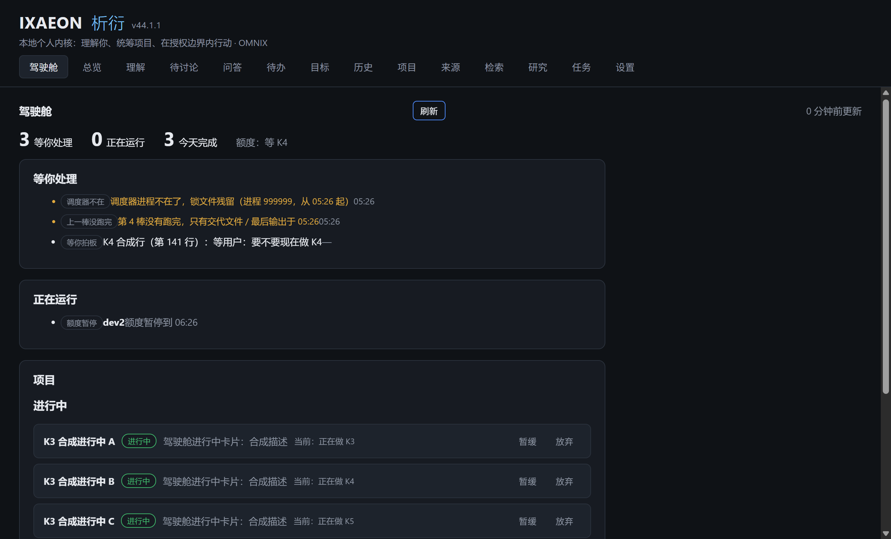

# K3b 驾驶舱页面：项目区 交付

- 分支：dev/K3b，基于 dev/K3（`5ba263f`）；档位 A
- 执行方：dev
- 这是 K3 的第二支：K3 的源码放进来会超过 300 行，按规格把「项目」区拆到这里。锁清单和
  交付说明各记各的，队列里还是第 140 行。

## 已实现

- `apps/desktop/src/renderer/src/pages/Cockpit.tsx`（相对 dev/K3：+128 / -14）：
  - 「进行中」展开成卡片（名称、描述、当前状态、状态徽标）；
  - 「暂缓」「放弃」各一行，显示数量（暂缓（10）/ 放弃（1）），点开才展开；
  - 卡片上的状态切换复用项目页的 `api.updateProjectStatus`；切完重新取快照；
  - 空快照时项目区显示「现在没有项目。」。
- 顺手把「正在运行」里的重复字收拾了：额度暂停不再把「额度暂停到 …」说两遍；调度器
  一条只留快照给的「调度器在转（进程 N），从 HH:MM 起」。不改 K2 的结构。
- 新增真机脚本 `scripts/real/k3-cockpit-page.mjs`（未计源码行数）；两张截图在
  `docs/委派/交付/附件/`。

## 验收测试（v2 规格任务）

- `apps/desktop/test/acceptance/k3b-cockpit-projects.test.ts`（锁定 1 个文件、3 条）：
  - 条件 3：项目各组 3 / 10 / 1 → 进行中 3 张卡片；暂缓（10）/ 放弃（1）默认折叠，
    点开后 10 张 / 1 张；
  - 条件 3：卡片上的状态切换调用 `api.updateProjectStatus`（暂停 → 放弃两次）；
  - 条件 5 的项目区：空快照 → 「现在没有项目。」，没有报错。
- 条件 1、2、4、5（其余各区）、6、7 在 K3 的测试里；两边的对照见
  `docs/委派/交付/K3.md`。两支合起来，规格 7 条条件都有测试。

## 自动化通过

- `node scripts/acceptance.mjs run K3`：3 个文件、13 条全过。
- `node scripts/acceptance.mjs run K3b`：1 个文件、3 条全过。
- `node scripts/acceptance.mjs check`：85 个任务的 165 个锁定验收测试都没被改。
- `node scripts/verify.mjs`：**退出码 0，全部通过**（lint、format:check、local-user、typecheck、
  build、unit、integration、acceptance-lock、已完成任务的验收、各套 review，含四组真 Electron
  界面复审）。
- GitHub 上的 verify：没看。接力里本棒只提交、调度器在棒末才推，分支 CI 要等推送之后才有。

## 真机通过

`node scripts/real/run-batch.mjs scripts/real/k3-cockpit-page.mjs`，退出码 0。合成数据：临时
数据目录 + 合成 relay 目录（lock 用脚本自己的 pid、ledger 3 棒、turns/4 未完成、dev2 额度
暂停到一小时后）+ 合成 git 仓库（origin/main 队列有一条「等用户」）+ 3 进行中 / 10 暂缓 /
1 放弃的合成项目。原样输出：

```text
===== scripts/real/k3-cockpit-page.mjs =====
[runner] 数据目录核对：起应用=是，IXAEON_DATA_DIR=有
BEFORE_BLOCK
驾驶舱
刷新

0 分钟前更新

1
等你处理
2
正在运行
3
今天完成
额度：等 K4
等你处理
等你拍板K4 合成行（第 141 行）：等用户：要不要现在做 K4—
正在运行
调度器在转（进程 45192），从 05:26 起
额度暂停dev2额度暂停到 06:26
这一棒—已跑 0 分钟第 4 棒在跑（最后输出于 05:26）
项目
进行中
K3 合成进行中 A
进行中
驾驶舱进行中卡片：合成描述
当前：正在做 K3
暂缓
放弃
K3 合成进行中 B
进行中
驾驶舱进行中卡片：合成描述
当前：正在做 K4
暂缓
放弃
K3 合成进行中 C
进行中
驾驶舱进行中卡片：合成描述
当前：正在做 K5
暂缓
放弃
K3 合成项目
进行中
暂缓
放弃
暂缓（10）放弃（1）
最近动态
05:26devK1完成第 1 棒（dev，任务 K1）：已完成
05:26integratorL13完成第 2 棒（integrator，任务 L13）：已完成
05:26integratorK2完成第 3 棒（integrator，任务 K2）：已完成
AFTER_BLOCK
驾驶舱
刷新

0 分钟前更新

3
等你处理
0
正在运行
3
今天完成
额度：等 K4
等你处理
调度器不在调度器进程不在了，锁文件残留（进程 999999，从 05:26 起）05:26
上一棒没跑完第 4 棒没有跑完，只有交代文件 / 最后输出于 05:2605:26
等你拍板K4 合成行（第 141 行）：等用户：要不要现在做 K4—
正在运行
额度暂停dev2额度暂停到 06:26
项目
进行中
K3 合成进行中 A
进行中
驾驶舱进行中卡片：合成描述
当前：正在做 K3
暂缓
放弃
K3 合成进行中 B
进行中
驾驶舱进行中卡片：合成描述
当前：正在做 K4
暂缓
放弃
K3 合成进行中 C
进行中
驾驶舱进行中卡片：合成描述
当前：正在做 K5
暂缓
放弃
K3 合成项目
进行中
暂缓
放弃
暂缓（10）放弃（1）
最近动态
05:26devK1完成第 1 棒（dev，任务 K1）：已完成
05:26integratorL13完成第 2 棒（integrator，任务 L13）：已完成
05:26integratorK2完成第 3 棒（integrator，任务 K2）：已完成
RED_ATTENTION_ITEMS 2
shots true true
RESULT 通过：默认打开驾驶舱、三组项目与计数可见、两张截图都在；改 pid 后红色「调度器进程不在了」
[runner] k3-cockpit-page.mjs 退出码=0｜RESULT 通过：默认打开驾驶舱、三组项目与计数可见、两张截图都在；改 pid 后红色「调度器进程不在了」

===== 汇总 =====
0	scripts/real/k3-cockpit-page.mjs	RESULT 通过：默认打开驾驶舱、三组项目与计数可见、两张截图都在；改 pid 后红色「调度器进程不在了」

共 1 个，非 0 的 0 个
```

两张截图（同一轮真机检查，合成数据）：





## Codex 审查（A 档）

见下（审完补）。

## 已知缺口

- K2 的快照里 `turn` 那一条没有角色/任务号（turns/ 下只有目录名和文件时间），所以「这一棒」
  一行只能显示「—」和「已跑 N 分钟」。要显示角色得改 K2 的读取范围，本单没改。
- K2 把 relay 标成 `stale` 时 `note` 是 null；页面回退显示「数据可能停了」，具体原因看不到。
  这是 K2 的缺口。
- 设置页保存路径不校验是不是 git 仓库；路径不对时驾驶舱顶部显示 K2 给的队列错误。
- 真机检查是合成数据，不是用户的真实 relay 队列；真实队列上还没有人点过。
- 截图里「K3 合成项目」是设置向导建的空项目，没有描述；不影响条件 3 的 3 / 10 / 1。

## 用户接受

未发生（用户用过并认可之后才写）。
